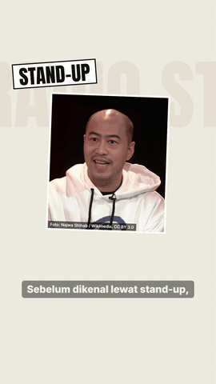
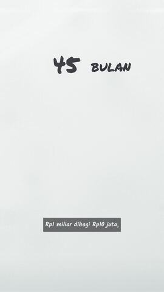

# kreyator-explainer

Package of agent skills for short explainer videos (Instagram Reels, TikTok, YouTube Shorts). `kreyator-explainer` is the package (plugin) name. It holds two independent skills, one per style:

| Skill | Style | Look |
|---|---|---|
| [`biografi-explainer`](skills/biografi-explainer/) | Biografi editorial | 9:16 motion graphic: photo cards, Anton tags, wipes, burn-in subtitles. 75 s, ElevenLabs VO, fast "Group C" render (DOM layers exported once, composited with canvas, piped to ffmpeg). |
| [`whiteboard-explainer`](skills/whiteboard-explainer/) | Whiteboard | Dry-erase marker on a glossy board, marker in hand, felt-eraser scene changes, synthesized marker sound. The medium is a fixed library; only the story is written per video. |

The agent picks the skill from the request: a person's biography or profile goes to `biografi-explainer`, and a whiteboard, marker or hand-drawn concept explainer goes to `whiteboard-explainer`.

## Examples

Real outputs made with these skills (downscaled to 540×960 for the repo; the originals are 1080×1920). Click a preview to open the MP4 with sound.

| Biografi editorial | Whiteboard |
|---|---|
| [](docs/examples/biografi-pandji.mp4) | [](docs/examples/whiteboard-rp1-miliar.mp4) |
| **Pandji Pragiwaksono: from radio to the stand-up stage**. 75 s, Group C render, ElevenLabs VO (one take, cut per scene). | **Rp1 miliar tanpa kerja, cukup berapa lama?** 66.5 s, 9:16 whiteboard with marker and eraser sound and ElevenLabs VO. |
| [MP4](docs/examples/biografi-pandji.mp4) · [Cover](docs/examples/biografi-pandji-cover.jpg) | [MP4](docs/examples/whiteboard-rp1-miliar.mp4) · [Cover](docs/examples/whiteboard-rp1-miliar-cover.jpg) |

Photo credits in the biografi example: Najwa Shihab/Wikimedia Commons (CC BY 3.0), Jawa Pos, via Malay Mail. These are shown on screen.

## biografi-explainer rules

- Output: 1080×1920, 9:16, 30 fps, MP4 H.264 + AAC, burn-in subtitles, safe zone 15% top and 20% bottom.
- Duration: 75 s target. Facts added to fill a short script are checked and sourced. Numbers, quotes and records are never made up.
- Voice-over: ElevenLabs, recorded as one take and then cut per scene (`audio/scene_NN.mp3`).
- Every video ends with a follow CTA. Every cover gets a brand badge (`cover-badge.mjs`).
- Delivery per video: `preview.mp4`, `cover-*.jpg`, `subs.srt`, per-scene audio, `vo-script.md` (script and sources), and `caption-metadata.md` (captions for IG, TikTok and YT Shorts). `final.mp4` is made only after approval.
- Checks before delivery: ffprobe frame count and duration, no frozen frames, black frames only at transitions, audio peak at or below −1 dB, and a contact sheet of key frames.
- The skill never publishes or schedules anything on its own.

`whiteboard-explainer` renders 1280×720 by default; see its `SKILL.md` for its rules. For Reels, TikTok or Shorts, frame it for 9:16, as in the example above.

## Install

```bash
npx skills add dionfananie/kreyator-explainer
# or, in Claude Code
/plugin marketplace add dionfananie/kreyator-explainer
/plugin install kreyator-explainer
```

Requirements:

- Node 18+, ffmpeg/ffprobe, and Chrome or Chromium.
- biografi-explainer: run `npm install` in a copy of `skills/biografi-explainer/biografi/scripts/` (installs rustwright, @napi-rs/canvas, @fontsource/anton, @fontsource/inter and playwright-core). Optional env vars: `FFMPEG_DIR`, `FFMPEG`, `RUSTWRIGHT_CHROMIUM`. `build-project.ps1` needs PowerShell.
- whiteboard-explainer: run `npm i playwright-core` in your work folder.
- ElevenLabs access for the voice-over.

## Use

Ask the agent, for example: "Buat video dari naskah biografi terbaru, 75 detik, jangan dipublish" or "Make a whiteboard explainer about compound interest."

Biografi flow, in short (full steps in `skills/biografi-explainer/styles/biografi.md`):

1. Write `script.txt` (one line per subtitle, `---` between scenes) and `piece.html` (start from `biografi/references/piece-contoh.html`).
2. Generate the VO in one take and save it as `audio_v4/full.wav`.
3. Run `align.mjs --target 72 --lead 1.0 --dur 75` to match text to audio and inject the timing.
4. Run `build-project.ps1 -StillsOnly …` to check stills, then do the full render with `-B … -Cover … -Vo … -Cuts …`.

Whiteboard by hand:

```bash
S=skills/whiteboard-explainer
cp $S/templates/piece.js my.js            # write the story
node $S/scripts/build.mjs my.js my.html
node $S/scripts/check.mjs my.html
node $S/scripts/render.mjs my.html my.mp4
```

## Layout

```
.claude-plugin/              package manifest (kreyator-explainer)
skills/
  biografi-explainer/
    SKILL.md                 rules + when to use
    styles/biografi.md       step-by-step flow and pitfalls
    biografi/scripts/        Group C render, align, cover badge, Commons download, music, srt
    biografi/references/     example piece.html and script.txt
    assets/icon.png
  whiteboard-explainer/      whiteboard libs, templates, scripts, references
docs/examples/               example videos, GIF previews and covers
```

## Credits and licenses

- `whiteboard-explainer/scripts/render.mjs`, `layout-check.mjs`, `sync-check.mjs`: from [iart-ai/javascript-animation-skills](https://github.com/iart-ai/javascript-animation-skills), MIT (see `scripts/LICENSE-motion-skills`).
- Fonts in `whiteboard-explainer/lib/fonts.css`: Permanent Marker (Apache 2.0) and Kalam (SIL OFL 1.1), from google/fonts; licenses in `lib/licenses/`.
- Biografi fonts: Anton and Inter via @fontsource (SIL OFL 1.1).
- Photos used in videos come from Wikimedia Commons or the source articles. Credit them on screen and in the caption.
